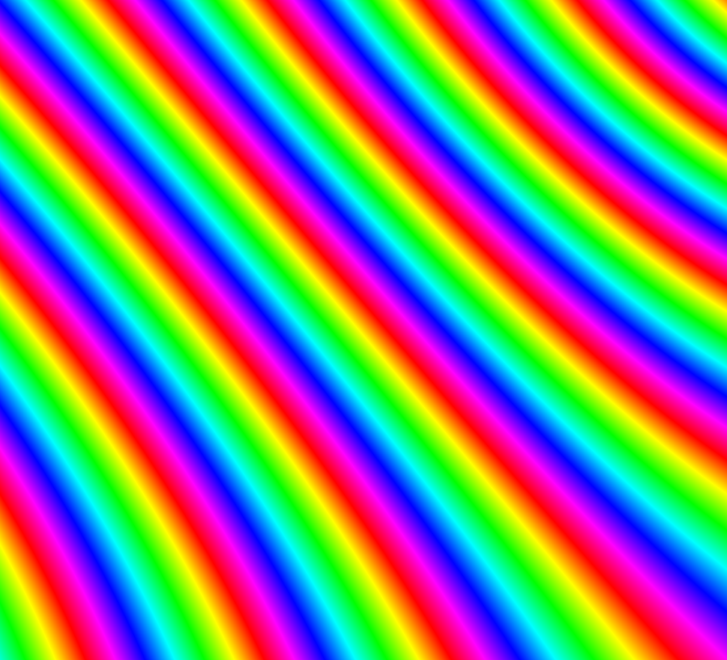
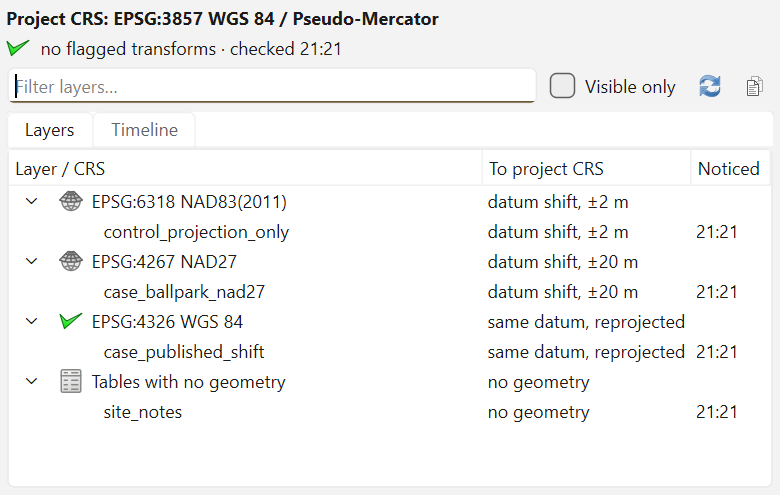
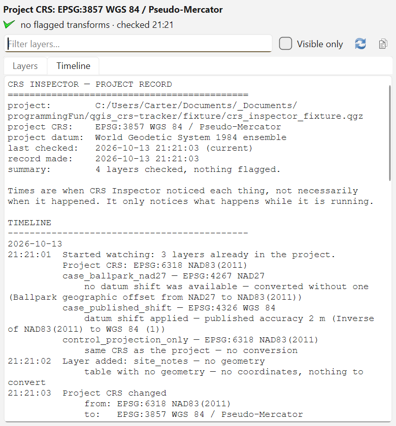

# CRS Inspector

**Inspect layer-to-project transformation evidence — including named ballpark
operations and unpublished accuracy across a datum boundary.**

CRS Inspector keeps a timestamped, plain-text record of every layer's route to the
project CRS — however small the step — and separates what that evidence establishes
from what it does not.

[](https://github.com/ChromiteExabyte/qgis-crs-inspector/actions/workflows/tests.yml)


QGIS knows which datum shift it applied to every layer and how good that shift is.
It tells you once, in a message bar, and then throws it away.

The dangerous case is a **ballpark transform**: PROJ finds no operation between two
datums and reprojects without shifting. Nothing looks wrong. Every layer is wrong in
the same direction, so they still align *with each other*. The export is metres out
and nobody finds out.



***Measured transformation comparison — design exploration, not a plugin screenshot.***
*Each colour cycle is 20 m of difference between two specified ED50 → WGS 84
operations, the ballpark and the best published one; the field runs from 42 m to
189 m. This is the disagreement between those two operations, not ground-truth
positional error — a shared error would cancel. Computed on a live PROJ install; see
[the interferogram mockup](mockups/interferogram.html).*

---

## The bug this exists to catch

`QgsCoordinateTransform.fallbackOperationOccurred()` looks like the ballpark signal.
It is not. Straight from [`spike/m0_crs_state.txt`](spike/m0_crs_state.txt):

```
FIXTURE  NAD27 grids   EPSG:4267 -> EPSG:6318
  candidate_operations:
    name:        NAD27 to NAD83(2011) (NADCON5, CONUS)
    accuracy_m:  0.18                     <- unavailable, grids not installed
    name:        Ballpark geographic offset from NAD27 to NAD83(2011)
    accuracy_m:  -1.0
  instantiated:
    name:        Ballpark geographic offset from NAD27 to NAD83(2011)
  BALLPARK_USED: False                    <- the flag, while a ballpark is in force
```

It reports that an **explicitly specified** operation failed and PROJ fell back. When
nothing is specified and PROJ simply picks a ballpark as its best available option —
the common case — the flag stays `False`.

The usable signal is a published accuracy of `-1`, but it is overloaded:
`EPSG:3857 → EPSG:4326` also reports `-1` and is perfectly healthy, because no datum
shift is involved at all. So the first cut is on **datum equality**, never the number:

|                     | same datum          | different datum      |
|---------------------|---------------------|----------------------|
| **accuracy known**  | shift               | shift                |
| **accuracy absent** | no shift — healthy  | **needs attention**  |

The bottom-right cell splits again, because PROJ documents a negative accuracy as
*"unknown or error"* — weaker than *"the datum shift was omitted"*. Only an operation
that names itself a ballpark supports the stronger claim; anything else is reported as
**unpublished accuracy across a datum boundary**. Both want attention. Only one states
a diagnosis.

Every direction of this is pinned in [`tests/test_grading.py`](tests/test_grading.py),
because getting it backwards fails loudly one way and silently the other.

I designed against `fallbackOperationOccurred()`, wrote a throwaway spike to check the
API before building on it, and the spike proved the design wrong. It corrected five
claims in total, recorded in [DESIGN.md §11](DESIGN.md).

## Install

Download the ZIP from the
[latest release](https://github.com/ChromiteExabyte/qgis-crs-inspector/releases/latest),
then **Plugins → Manage and Install Plugins → Install from ZIP**. Or build one with
[`tools/package.py`](tools/package.py).

Targets **QGIS 3.44 LTR (Qt5) and 4.x (Qt6)**. Qt imports go through the `qgis.PyQt`
shim — but that covers imports, *not* enum scoping, which is a separate Qt6 break that
stays invisible until a widget is constructed. See
[`crs_inspector/ui/qt_compat.py`](crs_inspector/ui/qt_compat.py). CI constructs the
panel on both toolkits for exactly that reason.

## What it does

A dock with the **project CRS** on top and two tabs.

**Layers** lists every layer grouped by its source CRS, with what happens on the way
to the project CRS and when CRS Inspector noticed it:



Nothing is too small to show. *Same CRS* and *same datum, reprojected* are different
rows, because they are different facts. The `±2 m` is the operation's **published
accuracy as a method**. It is not how far anything moved, and it is not an error bar
on any particular coordinate.

Grouping is navigation, not proof. One layer's probe can fail while another with the
same CRS succeeds, so every layer states its own line and a group whose members
disagree says *mixed*. Tables with no geometry get their own group, because they have
no coordinates to convert. **Visible only** hides unticked layers and those tables, and
the status line counts what it hid.

**Timeline** is the plain text that **Copy** puts on the clipboard, shown verbatim, so
what you paste is exactly what you saw:



```
21:21:01  Started watching: 3 layers already in the project.
          Project CRS: EPSG:6318 NAD83(2011)
          case_ballpark_nad27 — EPSG:4267 NAD27
              no datum shift was available — converted without one (Ballpark ...)
21:21:02  Layer added: site_notes — no geometry
21:21:03  Project CRS changed
              from: EPSG:6318 NAD83(2011)
              to:   EPSG:3857 WGS 84 / Pseudo-Mercator
```

It is written to be pasted into **your own LLM**, a job file, or an email. That is
deliberately the opposite of putting a model in the plugin: no API keys, no running
cost, no data leaving without a deliberate press of a button, and nothing to rot as
models change. The times are when CRS Inspector *noticed* each thing, and the record
says so. A layer that was already there when it started watching is never called
"added", because the plugin cannot know when it was loaded.

**Freshness is tracked separately from state.** Once an input change is observed, the
previous result stays readable but stops being presented as current. The status reads
`last checked 07:16 · inputs changed since`, and the copied record says `NOT CURRENT`.
A change to the project CRS, any layer's CRS, or the project's transformation
settings invalidates the result. The lifecycle checks drive the project-CRS and
layer-CRS edits through the plugin's real signal wiring; the transformation-settings
signal is wired the same way but no check drives it yet.

Severity is a themed QGIS icon, not a colour palette, so it survives the dark themes
and there is no cap on how many CRSs a project can hold.

## What it cannot see

**A layer with a wrong assigned CRS looks perfect.** The transformation is valid; the
premise is not. The text record says so, so a reader does not overclaim on your behalf.

Published accuracy is the nominal figure for an operation *as a method*, not measured
error at any point. And comparing two operations can never establish that either is
correct — a shared error cancels in the difference.

## Development

`crs_inspector/core/` imports no Qt and no PyQGIS except in `probe.py`, the single seam
where the QGIS API enters. Everything else is pure functions over dataclasses, so the
tests run on plain Python with nothing installed:

```bash
python -m pytest tests/ -q
python tools/package.py             # build the installable ZIP
python tools/verify_package.py      # load it standalone and check the fixture
```

`verify_package.py` extracts the ZIP, strips the repository from `sys.path`, and asserts
the import resolved to the extracted copy — so a development path can never supply what
the installed package lacks.

The spike still runs, headless against fixture CRS pairs or pasted into the QGIS Python
console against a real project:

```bash
"<OSGeo4W>/bin/python-qgis.bat" spike/m0_dump_crs_state.py
```

## Layout

| | |
|---|---|
| `crs_inspector/core/` | model, probe, grading, change sets, freshness, text record — no Qt |
| `crs_inspector/ui/` | the dock panel and the Qt5/Qt6 enum shim |
| `spike/` | the throwaway that corrected the design, its raw output, and the acceptance sheet |
| `fixture/` | a self-contained project with a control and two known cases |
| `mockups/` | interferogram and registration views, built from measured fields |
| `tools/` | packaging, verification, icon and image generation |
| `tests/` | model and classifier suites, no QGIS required |
| [DESIGN.md](DESIGN.md) | the model, what the spike settled, and what was tried and dropped |

## Status

Three different things, deliberately not collapsed into "done":

**Implemented:** model, probe, grading, change sets, observation freshness, per-layer
change subscriptions, the timeline record, and the two-tab dock.

**Automatically tested:** the model suite runs with no QGIS and no Qt installed. The
built package is then extracted and exercised on **both** Qt targets in CI (QGIS 3.44
LTR / Qt5 and 4.2 / Qt6): constructing the panel, clicking its buttons, checking the
fixture classifications, driving the plugin's real lifecycle, and proving that the
lifecycle checks fail when three specific regressions are put back.

**Desktop:** 0.1.0 was installed into a running QGIS by its author. That session asked
for the project CRS on screen, tabs, times on everything, a record that reads like
*"Bing Satellite, noticed at 09:14, CRS: …"*, wording less certain than "Assessment",
and a fix for a geometry-less GeoPackage table that "Visible only" could not hide.
0.2.0 is the response to that list. It has not yet had its own desktop
session. The screenshots above are the packaged panel rendered against the fixture
with real fonts, outside the QGIS main window.

Not built: persistence across sessions, pairwise layer comparison, and the
interferogram as an in-plugin tab.

## Licence

GPL-2.0-or-later. See [LICENSE](LICENSE).
